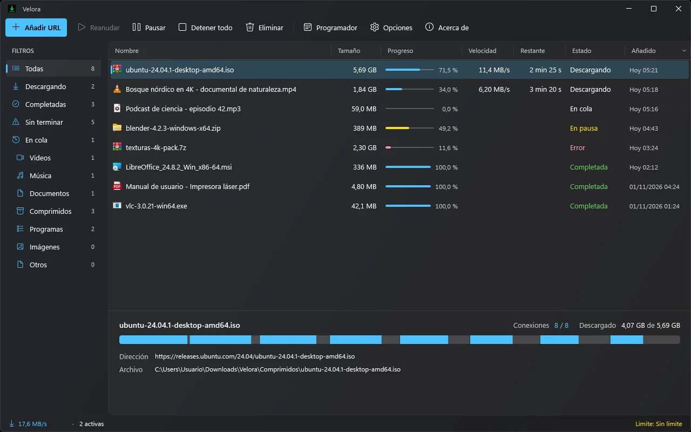
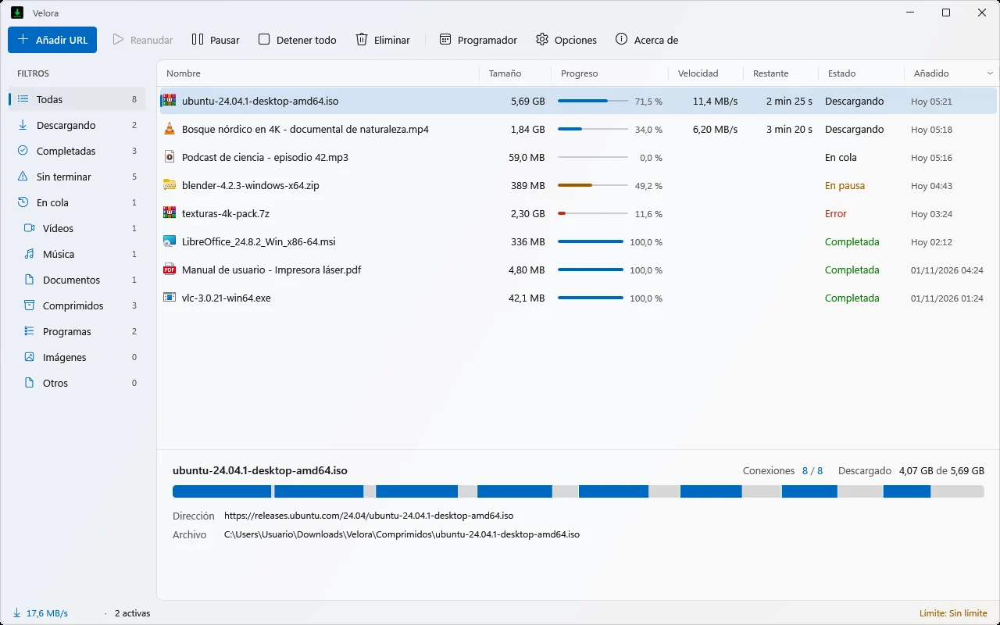
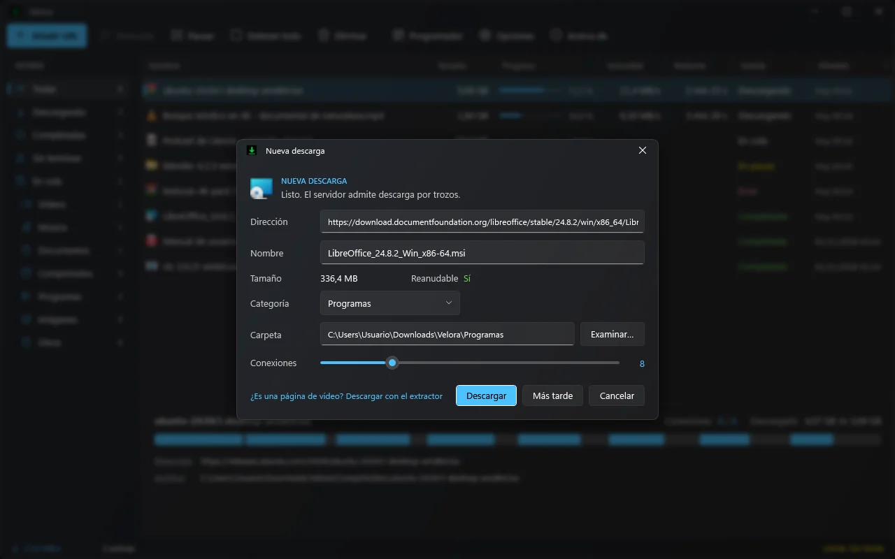
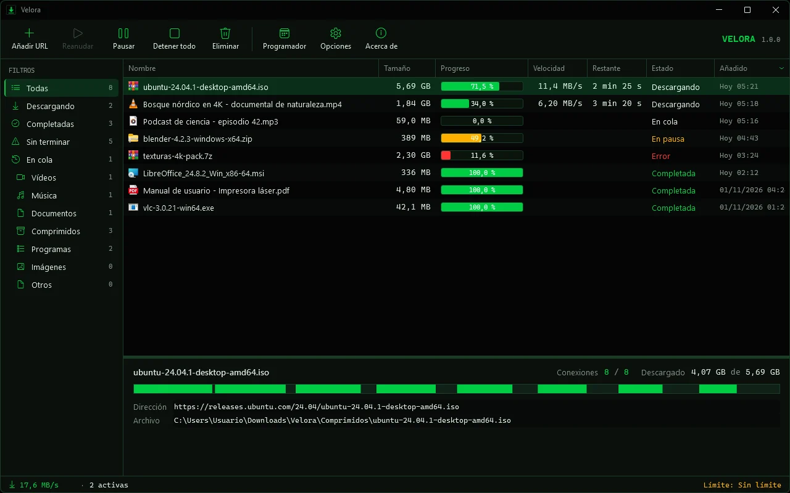
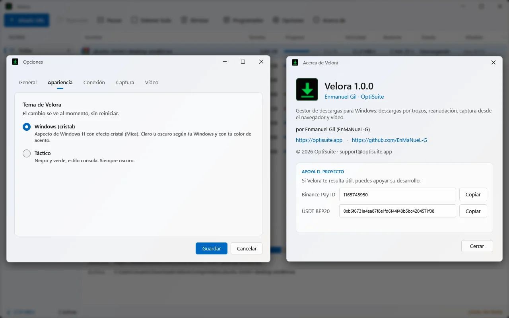

# Velora

&nbsp;

**Gestor de descargas para Windows, rápido y con motor propio.** Su motor divide cada archivo en
varias partes y las baja a la vez, reanuda tras cortes, cierre o reinicio del PC y descarga vídeo y audio de páginas web.
Con extensión para Chrome, Edge y Brave. **Sin anuncios y sin telemetría.** Gratis.

Parte de la suite **[OptiSuite](https://optisuite.app/velora/)** · Windows 10/11 (64 bits) · por Enmanuel Gil.

## Descarga

[**Velora-Windows.zip**](https://github.com/EnMaNueL-G/velora/releases/latest/download/Velora-Windows.zip) (~45 MB, versión 1.2.0).
Enlace a esta versión exacta: [Velora-1.2.0.zip](https://github.com/EnMaNueL-G/velora/releases/download/v1.2.0/Velora-1.2.0.zip).

## Requisitos

- Windows 10 u 11 de **64 bits**.
- **.NET 10 Desktop Runtime** (gratis, de Microsoft). Si no lo tienes: https://dotnet.microsoft.com/download/dotnet/10.0

## Instalación

1. Descarga el ZIP y descomprímelo (clic derecho → **«Extraer todo…»**).
2. Haz doble clic en **`Instalar Velora.cmd`**. No pide permisos de administrador: se instala en
   `%LOCALAPPDATA%\Programs\Velora` y crea accesos en el Escritorio y en el menú Inicio.
3. Si Windows avisa («Windows protegió su PC»): **«Más información» → «Ejecutar de todas formas»**. El ejecutable no está
   firmado con un certificado de pago.

**Desinstalar:** desde Configuración → Aplicaciones, o con `Desinstalar Velora.cmd`.

### Extensión para Chrome, Edge y Brave

No está en la Chrome Web Store, así que se carga **una sola vez** en modo desarrollador:

1. Abre `chrome://extensions` en tu navegador.
2. Activa el **Modo desarrollador**.
3. Pulsa **Cargar descomprimida** y elige la carpeta `extension` de Velora.

La extensión captura las descargas del navegador, añade **«Descargar con Velora»** al menú del clic derecho, pone un botón
sobre los vídeos y permite **descargar todos los enlaces** de una página.

## Qué hace

- **Motor multiconexión propio**: divide cada archivo en varias partes y las baja a la vez, **hasta 32 conexiones** (8 por
  defecto). Reparte el trabajo sobre la marcha: cuando una parte termina, ayuda a la más lenta.
- **Se adapta solo** si un servidor limita las conexiones.
- **Reanuda** tras un corte de internet, al cerrar el programa o al reiniciar el PC. Si el servidor cambia el archivo a mitad
  de la descarga, lo detecta y **no mezcla versiones**.
- **Vídeo y audio de páginas web** con yt-dlp, incluida la opción **solo audio MP3**.
- **Colas**, **programador** (con apagado opcional del PC al terminar) y **límite de velocidad**.
- **Categorías automáticas**, icono en la **bandeja** del sistema y **vigilancia del portapapeles**.
- Tema **Windows 11** con efecto cristal (Mica) claro u oscuro, y tema alternativo **«Táctico»**.

## Capturas

| Ventana principal (tema Windows, oscuro) | Tema Windows, claro |
|---|---|
|  |  |

| Nueva descarga | Tema «Táctico» |
|---|---|
|  |  |

| Opciones y Acerca de |
|---|
|  |

## Cifras medidas

- En un servidor que **limita la velocidad por conexión**, un archivo de 12 MiB tardó **12,1 s con 1 conexión** y
  **1,6 s con 8**: unas **7,6 veces más rápido**.
- Descarga real de **1 GB en 42 s** (24,5 MB/s) en la conexión del autor.
- Consumo en reposo de alrededor del **0,04 % de CPU**.
- **31 pruebas automáticas** superadas.

**Con honestidad:** si tu conexión ya va al máximo con una sola descarga, ningún gestor la supera. La ventaja de Velora se
nota cuando el servidor limita la velocidad de cada conexión.

## Seguridad y privacidad

- **Nunca sobrescribe** un archivo que ya tengas.
- Marca lo descargado como **procedente de internet** (Zone.Identifier) para que Windows y SmartScreen lo revisen.
- Pide **confirmación antes de abrir ejecutables**.
- Guarda las cookies y tokens que necesita **cifrados con DPAPI** de Windows.
- **No envía datos a nadie**: sin telemetría, sin cuentas y sin anuncios.
- Una página web **no puede iniciar descargas** sin que tú lo veas.

Descarga solo contenido para el que tengas derecho.

## Apoya el proyecto

Sin anuncios ni telemetría. Donación voluntaria por Binance:

- **Binance Pay ID:** `1165745950`
- **USDT (BSC · BEP-20):** `0xb6f6731a4ea87f8e1fd6f44f48b5bc4204571f08`

— Web: **https://optisuite.app/velora/** · Soporte: **support@optisuite.app**

## Licencia

Gratis para uso personal · código privado · © 2026 OptiSuite · Enmanuel Gil.

El código fuente de Velora no es público; este repositorio contiene las descargas (Releases) y la documentación.
Para vídeo y audio de páginas web, Velora usa yt-dlp.

---

**Firefox:** la carpeta `extension-firefox` del paquete trae la extensión para Firefox (instalación permanente solo en Developer Edition/Nightly; en Firefox normal como complemento temporal).

**Idioma:** Velora está en español e inglés (usa el idioma de Windows; se puede cambiar en Opciones → Apariencia) y avisa cuando hay una versión nueva.

## English

**Velora** is a free download manager for Windows 10/11 (64-bit), fast and with its own engine. Its
engine splits each file into up to 32 parallel connections (8 by default) and rebalances work on the fly, adapts when a
server limits connections, resumes after drops, closing the app or a reboot, and never mixes versions if the file changes
on the server. It also grabs video and audio from web pages (including audio-only MP3) with yt-dlp, and ships a browser
extension for Chrome, Edge and Brave. Queues, scheduler (optional shutdown), speed limit, automatic categories, tray icon
and clipboard monitoring. No ads, no telemetry.

- **Download:** [Velora-Windows.zip](https://github.com/EnMaNueL-G/velora/releases/latest/download/Velora-Windows.zip) (~45 MB, v1.2.0).
- **Requires:** [.NET 10 Desktop Runtime](https://dotnet.microsoft.com/download/dotnet/10.0).
- **Install:** unzip and double-click `Instalar Velora.cmd` (no admin; installs to `%LOCALAPPDATA%\Programs\Velora`).
  The executable is unsigned, so SmartScreen may ask: "More info" → "Run anyway".
- **Extension:** `chrome://extensions` → Developer mode → Load unpacked → Velora's `extension` folder.
- **Measured:** 12 MiB on a per-connection-throttled server: 12.1 s with 1 connection vs 1.6 s with 8 (≈7.6×); 1 GB in
  42 s (24.5 MB/s) on the author's line; ~0.04% CPU when idle; 31 automated tests passed. On a line that is already
  maxed out, no download manager can beat it.

Free for personal use · private source code · © 2026 OptiSuite · Enmanuel Gil.

**Language:** Velora is available in English and Spanish (it follows your Windows language; change it in Options → Appearance) and tells you when a new version is out.
